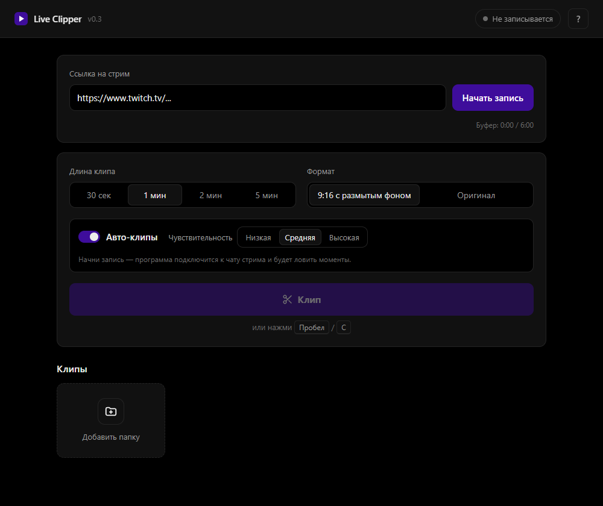

# Live Clipper

Программа для Windows, которая записывает живой стрим с Twitch или YouTube и одним нажатием сохраняет последние минуты в готовый клип.



## Возможности

- **Запись стримов Twitch и YouTube** — достаточно вставить ссылку на трансляцию.
- **Буфер 6 минут** — программа всё время держит в памяти последние 6 минут стрима, поэтому клип можно сделать уже после того, как момент случился.
- **Клипы от 30 секунд до 5 минут** — длина выбирается одной кнопкой: 30 сек, 1, 2 или 5 мин.
- **Формат 9:16 или оригинал** — вертикальное видео с размытым фоном для TikTok, Shorts и Reels или исходная картинка стрима.
- **Авто-клипы по реакции чата** — программа следит за чатом и сама сохраняет клип, когда зрители резко начинают писать больше обычного. Чувствительность: низкая, средняя или высокая.
- **Горячие клавиши** — `Пробел` или `C` делают клип так же, как кнопка «Клип».
- **Онбординг-тур** — при первом запуске программа коротко показывает, что где находится. Повторить тур можно кнопкой `?` в правом верхнем углу.

## Как установить

1. Откройте раздел [Releases](https://github.com/koritfull-rgb/live-clipper/releases) и скачайте файл `LiveClipper-Setup.exe`.
2. Запустите его — программа установится и откроется сама, на рабочем столе появится ярлык.

> **Windows может показать предупреждение** «Система Windows защитила ваш компьютер». Так бывает с программами без платной цифровой подписи.
> Нажмите **«Подробнее»**, затем **«Выполнить в любом случае»**.

## Как запустить из исходного кода

Нужен [Node.js](https://nodejs.org/) версии 18 или новее.

1. Скачайте проект и установите зависимости:

   ```bash
   git clone https://github.com/koritfull-rgb/live-clipper.git
   cd live-clipper
   npm install
   ```

2. Создайте в папке проекта папку `bin` и положите в неё два файла:

   - `ffmpeg.exe` — скачайте сборку для Windows с [gyan.dev](https://www.gyan.dev/ffmpeg/builds/) (например, `ffmpeg-release-essentials.zip`), распакуйте архив и возьмите `ffmpeg.exe` из папки `bin` внутри.
   - `yt-dlp.exe` — скачайте с [страницы релизов yt-dlp](https://github.com/yt-dlp/yt-dlp/releases/latest).

   Должно получиться так:

   ```
   live-clipper/
   └── bin/
       ├── ffmpeg.exe
       └── yt-dlp.exe
   ```

   Если папки `bin` нет, программа попробует найти `ffmpeg` и `yt-dlp` среди установленных в системе (в `PATH`).

3. Запустите программу:

   ```bash
   npm run dev
   ```

Собрать установщик `LiveClipper-Setup.exe` можно командой `npm run dist` — он появится в папке `dist`.

## Технологии

- [Electron](https://www.electronjs.org/) — окно программы
- [Node.js](https://nodejs.org/) — запись, нарезка и работа с чатом
- [ffmpeg](https://ffmpeg.org/) — обработка видео
- [yt-dlp](https://github.com/yt-dlp/yt-dlp) — получение видеопотока с Twitch и YouTube
